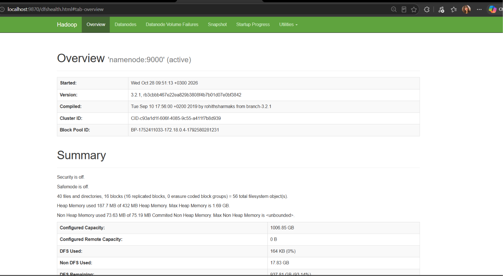
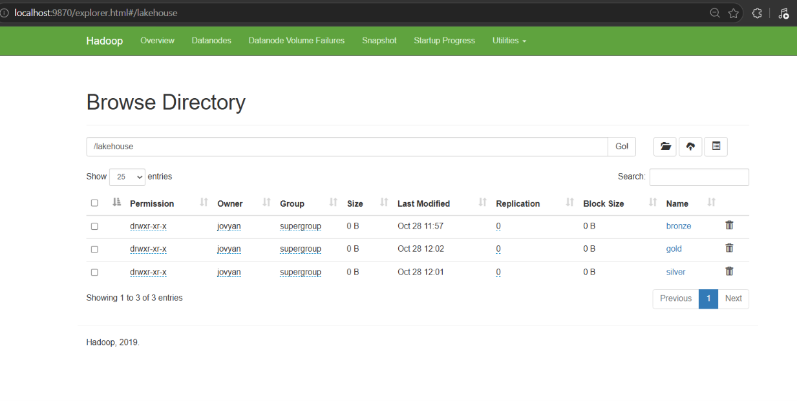
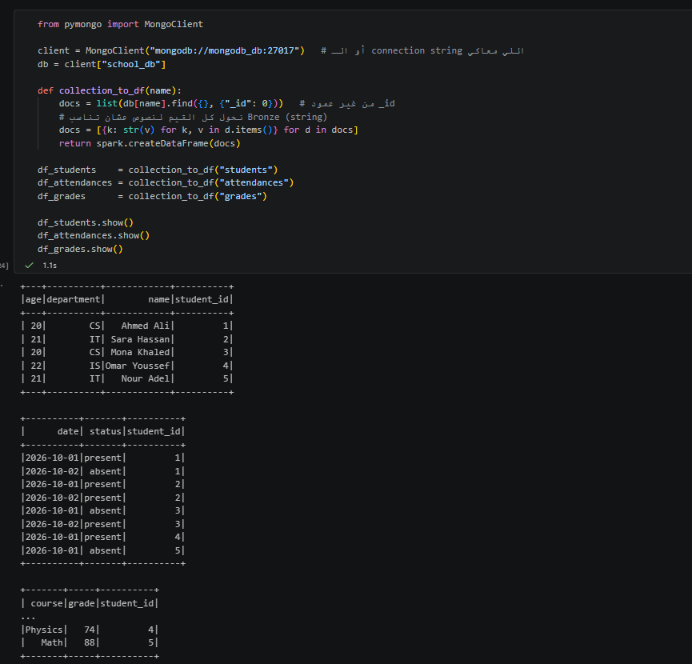
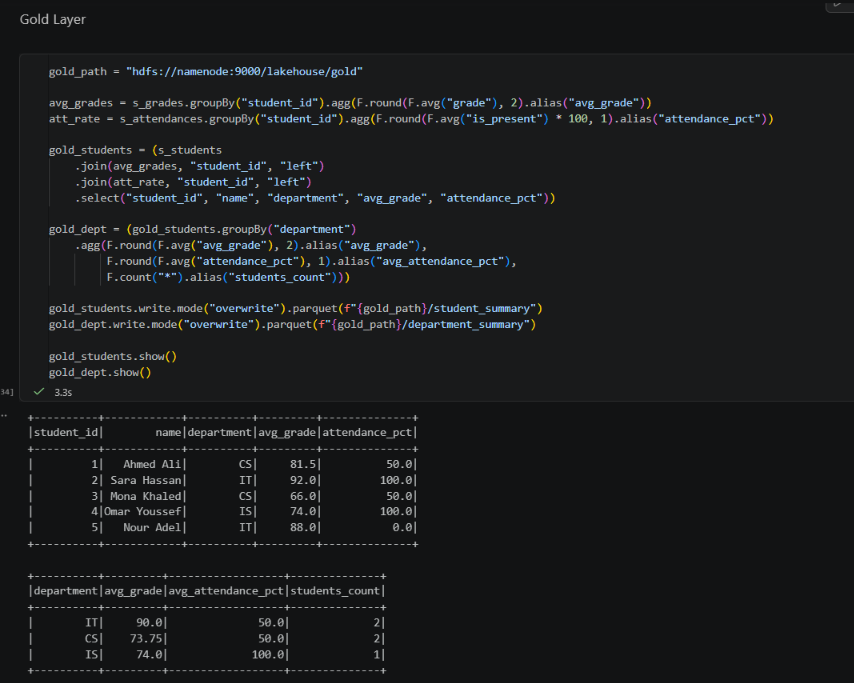

# Students Big Data Project: Medallion Architecture

A big data pipeline that reads student data from **MongoDB**, processes it with **PySpark**, stores it in **HDFS** as Bronze / Silver / Gold layers (Parquet), and exposes it as **Hive** tables queried from **DBeaver**.

```
MongoDB → PySpark → Bronze → Silver → Gold (HDFS) → Hive external tables → DBeaver
```

## Tech Stack

| Tool | Role |
|---|---|
| MongoDB | Source database (`school_db`) |
| Apache Spark 3.5 (PySpark) | Data processing (master + worker) |
| Hadoop HDFS | Storage for the data lake |
| Apache Hive 4.0 | SQL tables on top of the Parquet files |
| DBeaver | SQL client to query Hive |
| Jupyter | Notebook environment (runs inside Docker) |
| Docker Compose | Runs the whole stack |

## Project Structure

```
bigdataproject/
├── compose.yaml          # Docker services (HDFS, Spark, Jupyter, MongoDB, ...)
├── mongo_seed.js         # Inserts sample data into MongoDB
├── hive_tables.sql       # Hive schemas and external tables
├── notebook.ipynb        # PySpark pipeline (rename to your notebook file)
├── images/               # Screenshots used in this README
└── README.md
```

## Data

MongoDB database `school_db` with three collections:

| Collection | Columns |
|---|---|
| `students` | student_id, name, age, department |
| `attendances` | student_id, date, status |
| `grades` | student_id, course, grade |

## Medallion Layers

| Layer | What happens | HDFS path |
|---|---|---|
| **Bronze** | Raw data exactly as read from MongoDB (all columns as strings) | `/lakehouse/bronze` |
| **Silver** | Cleaned data: remove duplicates, trim text, cast types, validate grades (0 to 100), add `is_present` | `/lakehouse/silver` |
| **Gold** | Analytics tables: `student_summary` (avg grade and attendance % per student) and `department_summary` (per department) | `/lakehouse/gold` |

## How to Run

### 1. Start the containers

```powershell
docker compose up -d
```

### 2. Allow writing to HDFS

```powershell
docker exec namenode hdfs dfs -mkdir -p /lakehouse
docker exec namenode hdfs dfs -chmod -R 777 /lakehouse
```

### 3. Seed MongoDB

Connect VS Code (MongoDB extension) to `mongodb://localhost:27017`, open `mongo_seed.js`, and press **Play**.

### 4. Run the notebook

Open the notebook in VS Code and choose **Select Kernel → Existing Jupyter Server → `http://localhost:8888`** (the code must run inside Docker so that `spark://spark:7077` and `namenode` resolve). Run all cells in order:

1. Spark session
2. Read the 3 collections from MongoDB (`mongodb://mongodb_db:27017`)
3. Bronze
4. Silver
5. Gold

### 5. Start Hive

```powershell
docker run -d --name hive4 `
  --network bigdataproject_default `
  -p 10000:10000 -p 10002:10002 `
  -e SERVICE_NAME=hiveserver2 `
  -e SERVICE_OPTS="-Dhive.metastore.uris= -Dfs.defaultFS=hdfs://namenode:9000" `
  apache/hive:4.0.0
```

Wait about 2 minutes until port `10000` opens.

### 6. Create the Hive tables from DBeaver

1. New connection → **Apache Hive**: Host `localhost`, Port `10000`, Database `default`, Username `hive`.
2. Run the commands in `hive_tables.sql` one at a time (without the trailing `;`).
3. Query the layers:

```sql
SELECT * FROM bronze.students
SELECT * FROM silver.grades
SELECT * FROM gold.department_summary ORDER BY avg_grade DESC
```

## Useful Links

| Service | URL |
|---|---|
| HDFS NameNode UI | http://localhost:9870 |
| Spark Master UI | http://localhost:8080 |
| Jupyter | http://localhost:8888 |
| HiveServer2 Web UI | http://localhost:10002 |

## Screenshots

> Save each screenshot in the `images/` folder with the file name shown below.

### 1. Running containers


### 2. HDFS NameNode UI (`http://localhost:9870`)

Overview page:



Utilities → Browse the file system → `/lakehouse` (bronze, silver, gold):



### 3. Spark Master UI (`http://localhost:8080`)


### 4. Notebook output

Data read from MongoDB:



Gold tables:



### 5. DBeaver

Connection to Hive:


Database navigator (bronze, silver, gold schemas and tables):


Query results:


## Notes

- Hive table definitions are stored in Derby inside the `hive4` container. If the container is removed, re-run `hive_tables.sql`. The data itself stays safe in HDFS.
- `chmod 777` on `/lakehouse` is for local learning only, not for production.

## Author

Kenzy Ahmed